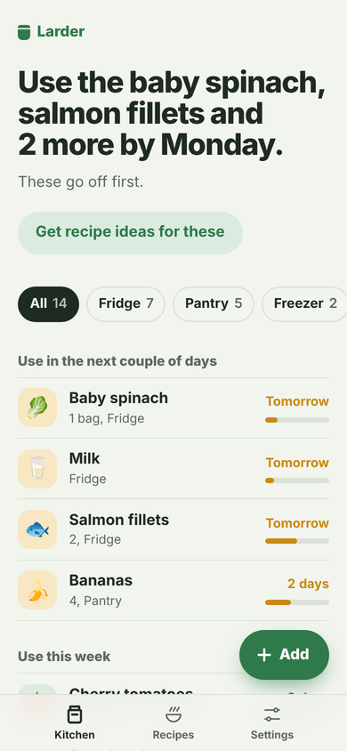
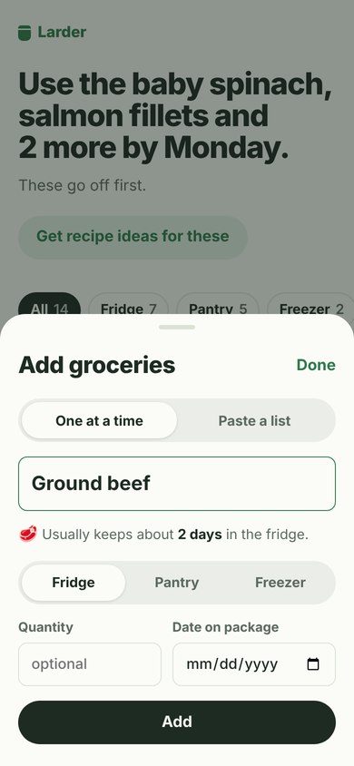
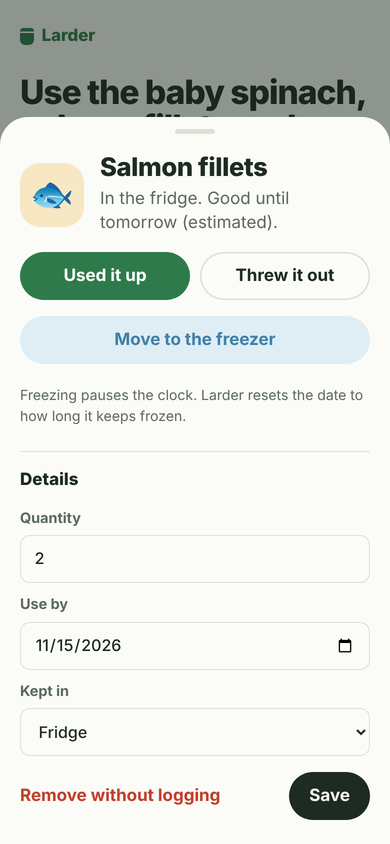
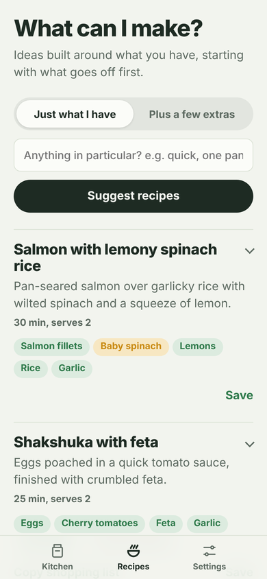

# Larder

Larder tracks the food in your kitchen, tells you what to use before it goes off, and uses Claude to suggest recipes built around whatever is about to expire.

It's an installable web app (PWA) with no build step and no runtime dependencies. It works offline, keeps your data on your device, and is hosted free on GitHub Pages.

<p>
  
  
  
  
</p>

## Features

- **Use-first headline.** The home screen opens with one sentence, like *"Use the spinach, salmon and milk by Monday."*
- **Automatic expiry estimates.** Type "chicken thighs" and Larder knows it keeps about 2 days in the fridge or 9 months frozen. About 60 food groups are covered, matched on the most specific keyword ("ground beef" before "beef", "sour cream" before "cream"). You can type in the date from the package instead.
- **Freezer support.** Moving something to the freezer resets its date to frozen shelf life. Taking it out to thaw gives it a short fridge use-by date (1 day for meat and fish).
- **Add a whole shop at once.** Paste `milk, 2 lemons, spinach`. Quantities are pulled out of the names and each item goes to the right place.
- **AI recipes.** Two modes: *Just what I have* (your ingredients plus basic staples) and *Plus a few extras* (up to 3 extra ingredients, with a shopping list you can copy). Ingredients about to expire go first in the prompt and are highlighted in the results.
- **Waste tracker.** Mark items as *used up* or *thrown out* and see your monthly record.
- **Daily reminders.** You can turn on notifications listing what goes off in the next two days. Installed Chrome/Android apps can also check in the background.
- **Offline and private.** Your data is stored in `localStorage`. Backups are JSON files and leave out your API key.
- Dark mode, reduced-motion support, keyboard focus states, and a layout built for phones first.

## Run it locally

```bash
git clone https://github.com/willshorthouse1-bit/larder.git
cd larder
npm start          # serves on http://localhost:5173 (python3 -m http.server)
npm test           # runs the unit tests with Node's built-in runner (Node 20+)
```

Any static file server works. There's nothing to install.

## Deploy to GitHub Pages

1. Push the repo to GitHub.
2. Go to **Settings → Pages** and set **Source** to **GitHub Actions**.
3. Push to `main`. The `deploy` workflow runs the tests and publishes the site to `https://<you>.github.io/larder/`.

To install it on your phone, open that URL. On iOS Safari, tap **Share → Add to Home Screen**. On Android Chrome, tap **Install app**.

## Recipe ideas setup

Recipes come from the [Anthropic API](https://docs.claude.com) using your own key:

1. Create a key at [console.anthropic.com](https://console.anthropic.com).
2. In Larder, open **Settings → Recipe ideas** and paste it in. You can also add dietary preferences there.

The browser calls the API directly, using the `anthropic-dangerous-direct-browser-access` header. That's fine for a personal app where the key belongs to you and stays on your device. Don't put a shared key in a public deployment. If you want to share the app with other people, put a small server-side proxy in front of the API (see the roadmap below).

## How it's built

```
index.html            app shell, tab bar, sheet and toast containers
styles.css            design tokens (light and dark) and components
sw.js                 offline cache, background reminders
src/
  shelfLife.js        food database and keyword matching
  dates.js            timezone-safe calendar maths on YYYY-MM-DD strings
  inventory.js        pure item logic: create, freeze, thaw, status, grouping
  recipes.js          prompt builder, response parser, API client
  store.js            persistent state with subscribe/update
  app.js              hash router, re-rendering, reminders
  ui/                 kitchen, recipes and settings views
tests/                node:test unit tests for all pure logic
```

**Design decisions**

- **No framework, no build step.** Native ES modules and a small `html` tagged template that escapes input by default. Everything loads straight from GitHub Pages, and the whole app is a few dozen kilobytes.
- **Pure core, thin UI.** Expiry, freezing, grouping, prompt building and parsing are plain functions with no DOM access, so they're fully unit-tested. The API client takes an injectable `fetch`.
- **Dates as local calendar strings.** Storing `YYYY-MM-DD` instead of timestamps means "expires Tuesday" stays Tuesday whatever your timezone or the time you added it.
- **Strict JSON from the model.** The prompt asks for a fixed schema. The parser tolerates code fences and stray text and drops malformed entries.

## Roadmap

- [ ] Barcode scanning to add items (BarcodeDetector API / Open Food Facts)
- [ ] Receipt photo import using Claude vision
- [ ] Optional sync between devices
- [ ] Serverless proxy (Cloudflare Worker) so the app can be shared without a personal key
- [ ] Shopping list built from recipe extras

## Disclaimer

Shelf lives are typical estimates for food stored properly, based loosely on public guidance such as the USDA FoodKeeper. Trust the package date, and your own judgement, first.

## License

[MIT](LICENSE)
